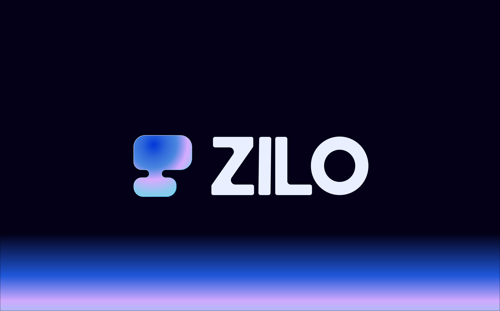
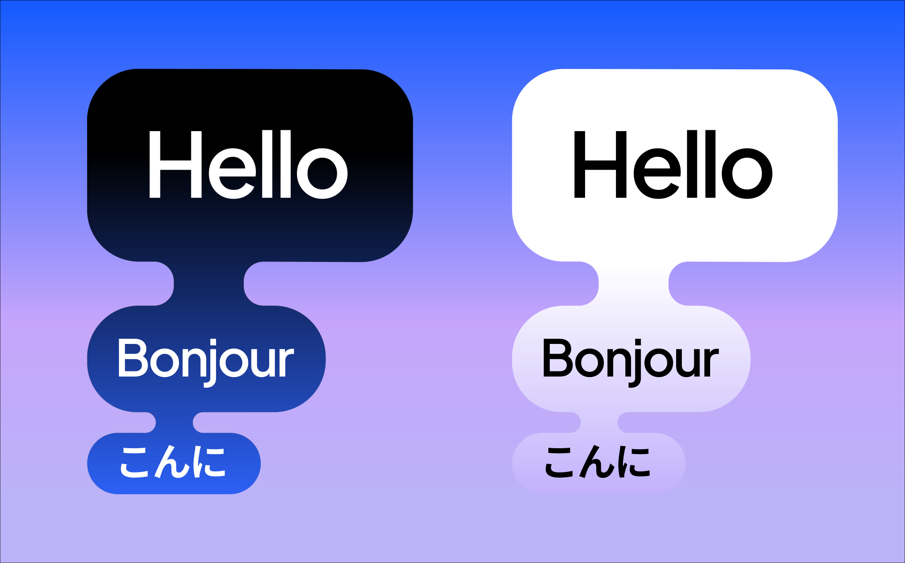
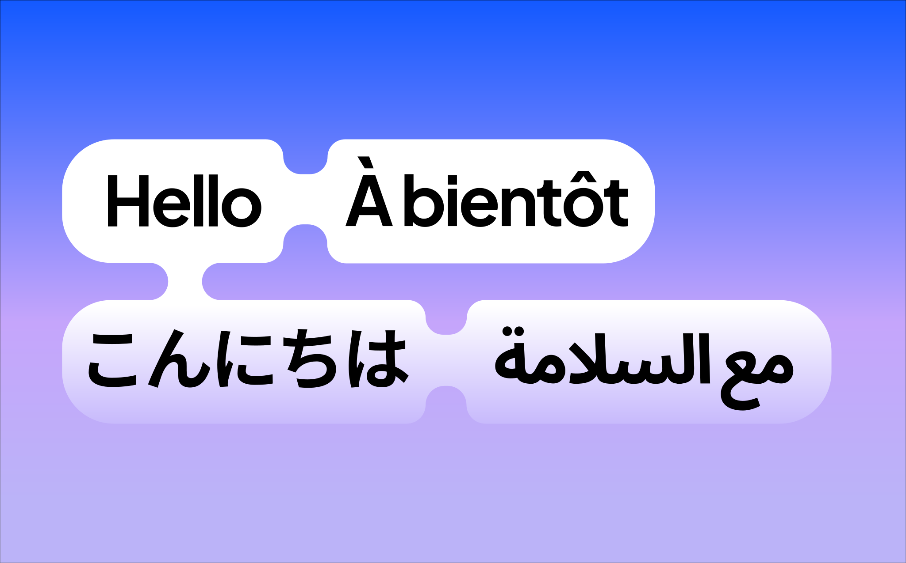

<h1>Zilo is the next-generation innovative AI-powered language learning platform.</h1> 

<h1>The symbol consists of two speech bubbles, large and small, forming an abstract "Z". The small bubble represents the starting point of learning, while the large one symbolizes language mastery. The upward motion embodies the brand values of "progress" and "growth".
</h1> 

<video width="100%" controls autoplay muted loop>
    <source src="/assets/videos/zilo_1.mp4" type="video/mp4">
</video>
<h1>The smooth fluid connector is the core design element, metaphorically representing semantic fusion and emotional connection, illustrating how vocabulary weaves into a network of meaning.
</h1> 
