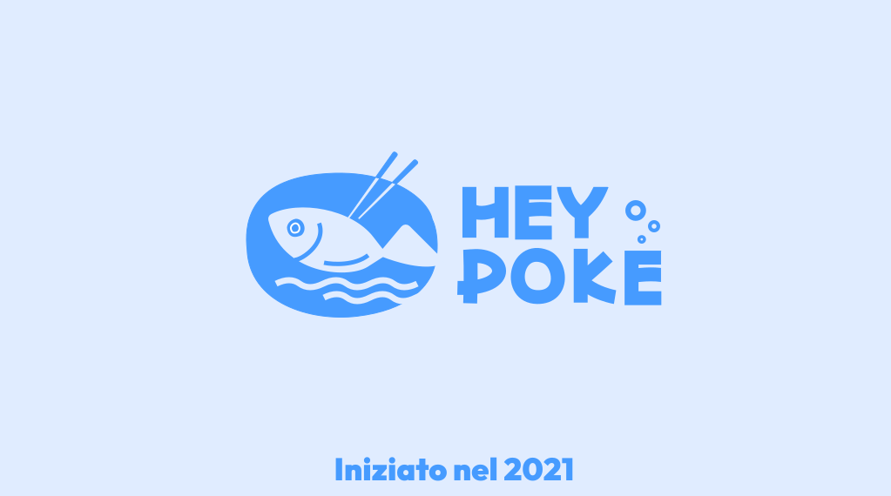
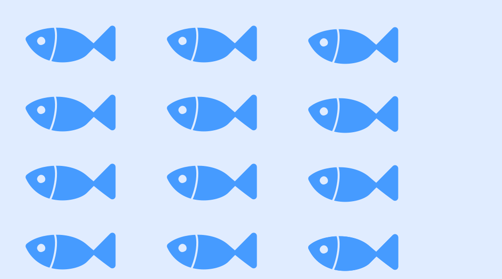
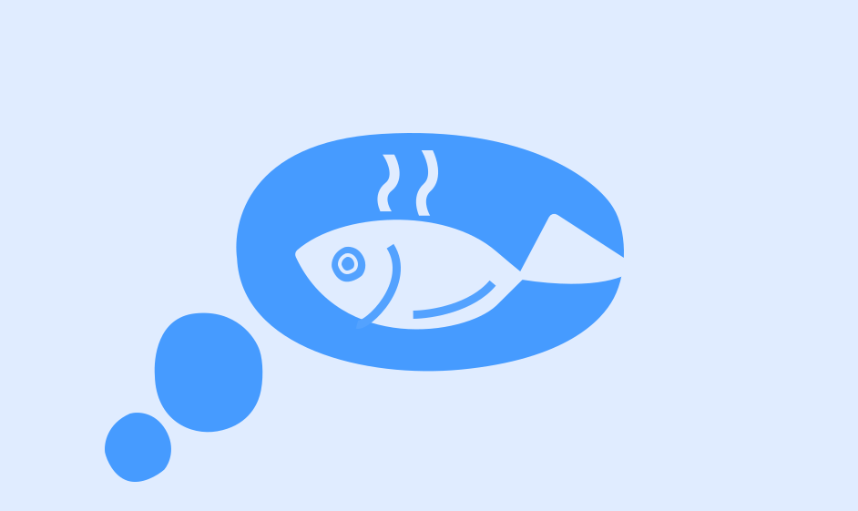
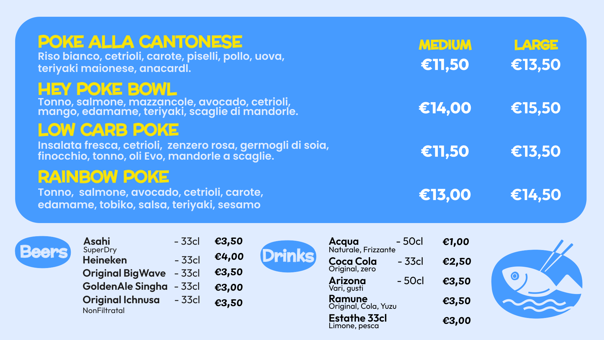

<figure class="half">
<h1>The HEYPOKE is a distinctive Italian poke bowl restaurant. Founded in 2021, HEYPOKE rapidly rose to prominence in less than three years. They have now embarked on an active transformation and expansion of their business footprint. TheMeMeCat has been asked to create a fresh brand identity that is both recognizable and versatile.</h1>
<h2>HEYPOKE是一家极具特色的意大利夏威夷盖饭餐厅。成立于2021年的HEYPOKE在不到三年的时间里迅速崛起，并开始积极的转型与扩张业务版图，TheMeMeCat应要求为其重新设计一个更具识别度和通用性的全新品牌形象。</h2>
</figure>

<figure class="half">
<h1>The Poke bowl is a gift of marine.Inspire by the lively ocean & dining experience of poke bowl, we adopts an immersive and bright color palette along with a vibrant composition for its new brand identity.</h1>
<h2>Poke bowl来源于海洋的馈赠。启发于海的活泼和poke的用餐方式，新的品牌形象采用了更沉浸明透的配色与富有活力的构图。</h2>
</figure>

